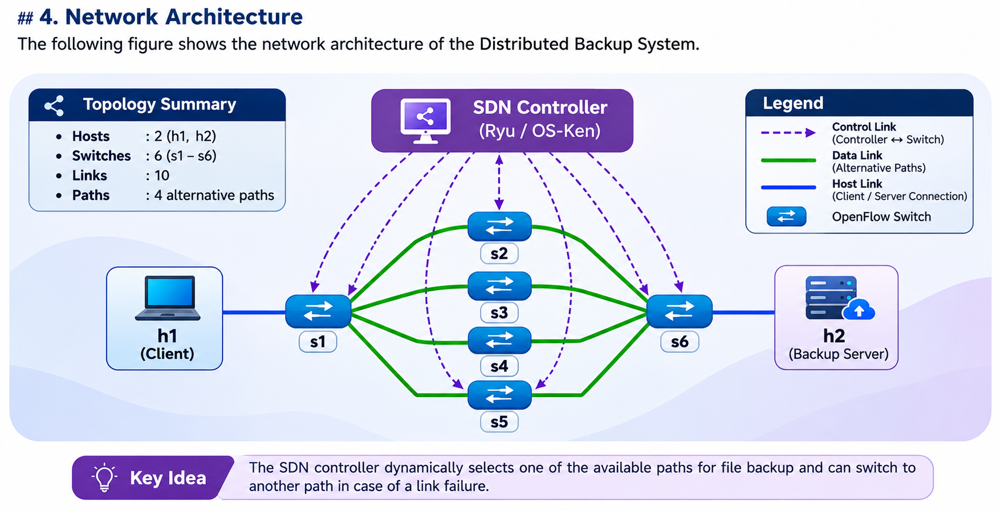

# Distributed Backup System Using TCP and SDN

## 1. Project Overview

The Distributed Backup System
          
## 2. Problem Statement:
          Implement a distributed backup application where client transfer files to the backup servers through the TCP.
          SDN should dynamically select suitable paths and support the recovery during the links failures.
## 3. Objectives

- Enable multiple clients to upload files.
- Transfer files using TCP.
- Maintain file integrity using SHA-256 hashing.
- Allow users to list and delete backup files.
- Use SDN for network path management.

## 4. Network Architecture

The following figure illustrates the network architecture of the Distributed Backup System.

